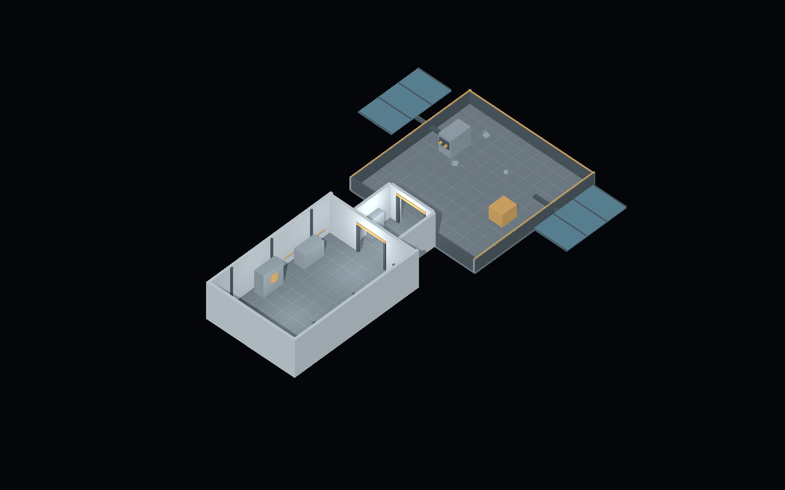

# Orbital Rescue

Politecnico di Torino · Virtual Reality 2026/2027 · Group 09

An astronaut restores a debris-damaged space station. The intended five-to-ten-minute VR experience follows a mission briefing, an airlock transition, debris collection and power-interface repair. A1 establishes the environment layout through a desktop first-person walkthrough.

[A0 working document](https://docs.google.com/document/d/1Pux0m5rE4q6pS4W2nduYv1G0DQx8AVyatSrTpV7JYqw/edit?tab=t.0#heading=h.nauhafqlymq3) · [References and floor plan](Docs/References/README.md)

## Run

1. Check out `assignment-1` and add the repository root to Unity Hub.
2. Open with **Unity 6000.4.4f1** and allow Package Manager to resolve dependencies.
3. Open **`Assets/Scenes/Blockout.unity`** and press **Play**. Click the Game view if the mouse is not captured.
4. Walk through the mission area, airlock and exterior platform, then return.

| Action | Keyboard / mouse | Gamepad |
| --- | --- | --- |
| Move | WASD / arrows | Left stick |
| Look | Mouse | Right stick |
| Sprint | Hold Shift | Hold left stick press |
| Release cursor | Escape | Start (toggle) |
| Resume | Left click | South button / Start |
| Return to spawn | R | Select / back |

## Environment

One Unity unit equals one metre. The mission area is 8×12 m, the airlock 4×4 m and the exterior deck 12×12 m. The open hatches provide 2.4×2.6 m clearance. The player capsule is 1.8 m high, with the camera 1.65 m above its origin. Walking speed is 2.5 m/s; sprint speed is 4.5 m/s.

The scene uses **Unity primitives, not ProBuilder**. Geometry is saved in the scene and can be edited directly in the Hierarchy and Inspector. See [reference images, floor plan and scene mapping](Docs/References/README.md).

Equipment and debris are static blockout placeholders. VR locomotion, grabbing, interactive doors, repair logic, sound and final art are later milestones. The exterior deck is an A1 walking aid.

## Repository

| Path | Contents |
| --- | --- |
| `Assets/Scenes` | Editable Blockout scene |
| `Assets/Prefabs` | Reusable Player prefab |
| `Assets/Scripts` | First-person controller and control legend |
| `Assets/Input` | New Input System action asset |
| `Assets/Materials` | Flat blockout materials |
| `Assets/Settings` | URP renderers, quality pipelines and volume defaults |
| `Packages` | Package manifest and dependency lockfile |
| `ProjectSettings` | Unity project configuration |
| `Docs` | Reference images, floor plan and scene overview |

The project uses **Input System Package (New)** only. Scene geometry is not generated at runtime. Edit the scene in Unity; edit shared player settings through `Player.prefab`.

## Course delivery

[A1 assignment](https://cgvg-polito.notion.site/A1-3edc27e51e0f8189bbbcfec70f0194d8) · [Course page](https://cgvg-polito.notion.site/Virtual-Reality-2026-2027-5cac27e51e0f83db85bc812337ddbccd)

A1 is delivered on `assignment-1`; the deadline is **15 November 2026, 23:59 Europe/Rome**. Verify the pushed commit on GitHub. The teacher `francescoStrada` must be a repository collaborator. Use another branch for work after the deadline.
