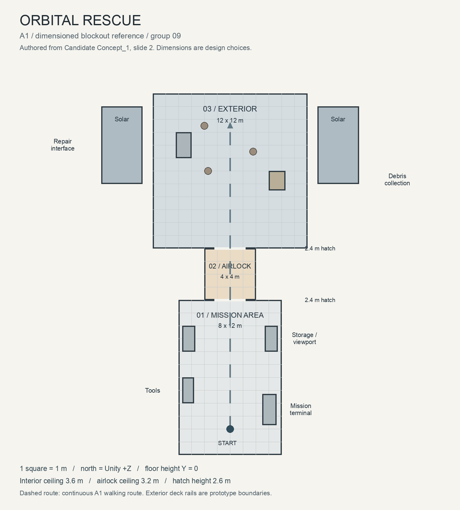

# Orbital Rescue

**Internal project name:** Orbital Rescue / 轨道救援

**Course / group:** Politecnico di Torino, Virtual Reality 2026/2027, group 09

An astronaut returns a debris-damaged space station to operation. In the intended five-to-ten-minute VR experience, players prepare inside the station, pass through an airlock, collect space debris and reconnect a damaged power interface. Visual motion and object interaction explore the perception of weightlessness.

**[A0 working document](Docs/A0-working-document.md)** · [Supplied concept deck](Docs/References/Candidate%20Concept_1.pptx)

The linked A0 file is an initial repository-local working draft based on the supplied concept, not a finalized A0 submission. The group can replace this link with its existing shared document.

## Open the A1 walkthrough

1. Clone this repository and check out **`assignment-1`**. The Unity project is at the repository root.
2. In Unity Hub, choose **Add project from disk** and select the folder containing `Assets`, `Packages` and `ProjectSettings`.
3. Use **Unity 6000.4.4f1** (Unity 6.4, satisfies A1's 6.3-or-newer requirement). Allow Package Manager to resolve the pinned dependencies. No Asset Store imports are needed.
4. Open **`Assets/Scenes/Blockout.unity`**, then press **Play**. Click the Game view to capture the mouse if necessary.
5. Walk from the mission area through the airlock to the exterior deck, inspect both sides, then return. Exit Play mode before editing the blockout.

The saved scene contains all geometry and a player prefab instance. It can be inspected and edited before Play. Rebuilding is optional: **Orbital Rescue → Rebuild A1 Blockout** replaces the scene with the reference layout and warns before overwriting manual changes.

## Controls

| Action | Keyboard / mouse | Gamepad |
| --- | --- | --- |
| Move | WASD or arrow keys | Left stick |
| Look | Mouse | Right stick |
| Sprint | Hold Shift | Hold left stick press |
| Release cursor / pause movement | Escape | Start (toggle) |
| Resume | Left click | A / south button or Start |
| Return to start | R | Select / back |

The 1.8 m character capsule has a 1.65 m eye height. Movement is 2.5 m/s, sprint is 4.5 m/s. Diagonal movement is normalized. Mouse displacement and gamepad angular speed are handled separately. Camera pitch is limited to ±80°. Losing application focus releases the cursor and stops navigation until capture resumes.

## Blockout and reference



**1 Unity unit = 1 metre.** The interior is 8×12 m, the airlock 4×4 m and the exterior deck 12×12 m. Both hatches have 2.4×2.6 m clear openings. The metre grid, simple equipment volumes and on-screen zone legend support spatial review. The walkthrough follows the plan from Unity z=2 through both hatches to z=27.

The supplied concept defines the three-zone sequence and major objects. The dimensioned plan is an explicitly authored A1 interpretation, not a measured reconstruction of a real space station. Original concept images, provenance and scene mapping are in **[Docs/References](Docs/References/README.md)**.

A1 uses primitives with flat identification materials and neutral preview lights. The terminal, tools, repair panel, debris bin, solar arrays and debris are static placeholders. The distant plain sphere is an Earth scale cue. The exterior deck and rails support desktop inspection; VR locomotion, interactive doors, grabbing, repair logic and the A2 art/lighting pass are future work. ProBuilder is optional in A1; these volumes remain directly editable GameObjects without an extra geometry package.

## Input and project structure

- `Assets/Input/OrbitalRescue.inputactions`: inspectable **new Input System** action asset.
- `Assets/Scripts/FirstPersonController.cs`: desktop controller, CharacterController collisions and input lifecycle. Each instance owns its action asset clone.
- `Assets/Prefabs/Player.prefab`: controller, child camera and walkthrough legend.
- `Assets/Scenes/Blockout.unity`: saved, editable environment and player instance; enabled in Build Settings.
- `Assets/Editor`: explicit scene builder and capture commands, excluded from player builds.
- `Assets/Tests`: scene acceptance and virtual-device PlayMode tests.
- `Docs/Validation`: rendered views and verification record.

Project Settings use **Input System Package (New)** only. No legacy Input Manager polling is used. Dependencies and their lockfile are committed. `Library`, `Temp`, logs and test artifacts are ignored.

## Verification

Close the Unity instance using this project, then run:

```bash
./Tools/verify.sh
# Override the executable for another installation:
UNITY_EDITOR="/path/to/Unity" ./Tools/verify.sh
```

Requires Bash and Python 3 for reading the Unity XML results. The script runs all EditMode and PlayMode tests and fails on missing results, failures, skips or an empty suite. Results are in ignored `TestResults/`. The tests use virtual Input System devices, restoring the editor's focus settings after each test. They do not change normal gameplay input routing.

To capture scene views in Unity, choose **Orbital Rescue → Capture A1 Views**. This opens the saved blockout. Save any manual edits first. The overview temporarily hides ceilings only for the image; the saved scene keeps them.

See **[A1 requirement-by-requirement checklist](Docs/A1-checklist.md)** for actual verification evidence and any external submission items still pending.

## Submission

Deliver the last pushed commit on **`assignment-1`**. According to the [A1 assignment](https://cgvg-polito.notion.site/A1-3edc27e51e0f8189bbbcfec70f0194d8), the deadline is **15 November 2026, 23:59 Europe/Rome**. Only the commit received by GitHub counts. After the deadline, make further changes on a new branch.

The repository must include teacher **`francescoStrada`** as a collaborator. Check **Settings → Collaborators** and confirm membership or a pending invitation. Public repository visibility alone does not establish collaborator membership.

[Course page](https://cgvg-polito.notion.site/Virtual-Reality-2026-2027-5cac27e51e0f83db85bc812337ddbccd)
